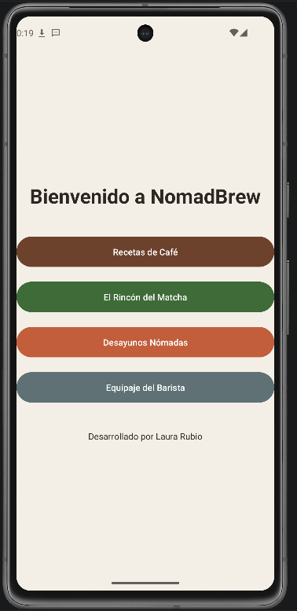
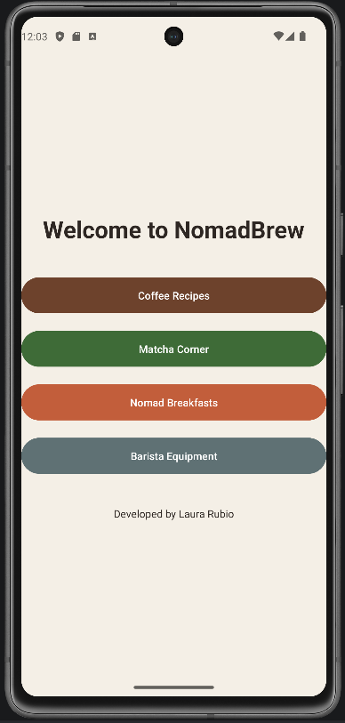
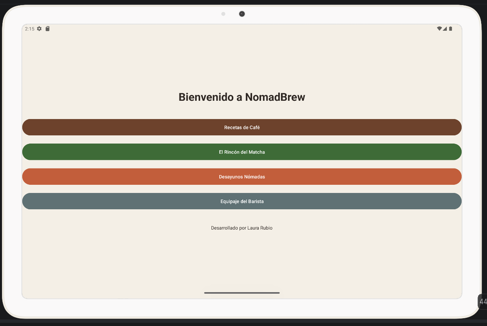
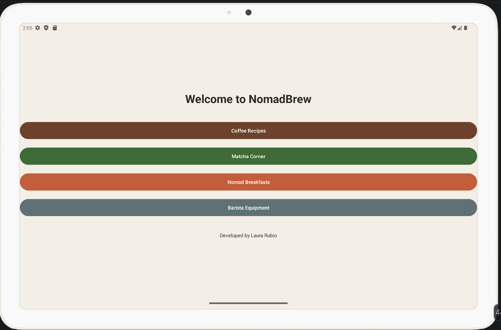
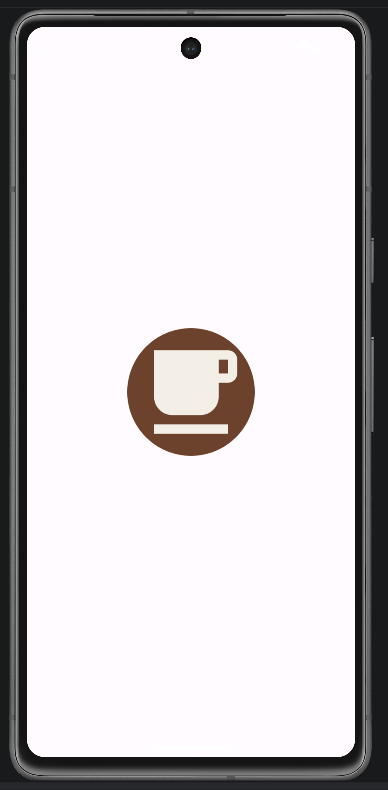
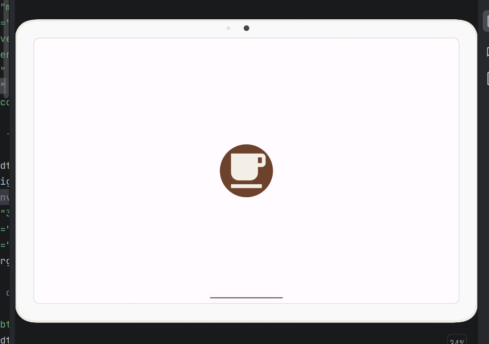

## 🚀 Arquitectura y Conceptos Técnicos

El proyecto no es solo una interfaz gráfica, sino que aplica estándares profesionales de Ingeniería de Software y buenas prácticas de Android

*   **Desarrollo Nativo y Compatibilidad:** Desarrollada en Java y XML usando la plantilla *Empty Views Activity*. El proyecto está configurado para la **API 24 (Android 7.0)**, garantizando que la aplicación sea compatible con más del 95% de los teléfonos del mercado actual.
*   **Gestión Eficiente y "Zero Hardcoding":** Todos los textos, colores y dimensiones han sido extraídos del código visual y centralizados en el directorio `res/values` (`strings.xml`, `colors.xml`, `styles.xml`).
*   **Internacionalización Automática (i18n):** La app soporta múltiples idiomas. Mediante el uso del directorio `values-en`, el sistema detecta el idioma del dispositivo y traduce toda la interfaz al inglés de forma transparente para el usuario.
*   **Rendimiento y Almacenamiento:** Optimizada para ser muy ligera (APK inferior a 15 MB)[cite: 13]. Esto se logra mediante el uso de gráficos vectoriales (XML) para los iconos estructurales y formato WebP para las imágenes reales de alta resolución
*   **Diseño UI/UX Adaptativo:** Uso de un `LinearLayout` flexible y unidades de medida relativas (`dp` y `sp`). Esto permite que la interfaz escale proporcionalmente tanto en smartphones como en tablets sin perder su estructura.
*   **Accesibilidad en Exteriores (RNF-03):** Teniendo en cuenta que el usuario usará la app al aire libre y con las manos ocupadas preparando café, todos los botones se han configurado con un área táctil mínima de `56dp` mediante estilos globales, facilitando su pulsación sin frustraciones.

---

## 🎨 Semántica Visual y Psicología del Color

La paleta de colores no es casual, ha sido diseñada semánticamente para evocar la naturaleza y guiar al usuario por la aplicación:

*   🏕️ **Fondo Arena (`background_arena`):** Un color base cálido y neutro que simula la lona de una tienda de campaña, reduciendo la fatiga visual frente a la luz del sol.
*   ☕ **Botón Café (`btn_coffee`):** Un tono marrón tostado que simula la textura y espuma del café de especialidad
*   🍵 **Botón Matcha (`btn_matcha`):** Verde hoja natural que hace referencia a la naturaleza y a la infusión del té matcha
*   🌅 **Botón Desayunos (`btn_breakfast`):** Un terracota pálido que transmite la sensación de un amanecer en el campo
*   🎒 **Botón Equipaje (`btn_equipment`):** Gris pizarra que representa el color del equipamiento de montaña y la mochila

El icono de la aplicación (`mipmap`) se ha diseñado como **Adaptive Icon**, fusionando la temática del café con elementos de acampada para integrarse perfectamente en el lanzador de cualquier dispositivo Android.

---

## 📄 Memoria Técnica y Documentación

El análisis exhaustivo del proyecto se encuentra documentado en la memoria técnica. En ella se incluyen:
* Análisis de limitaciones móviles y ciclo de vida de la Activity (diagramas de estado)
* Extracción y priorización de Requisitos Funcionales y No Funcionales
* Diagramas de Casos de Uso
* Justificación completa del diseño gráfico y la arquitectura del código

📂 **Puedes consultar el documento completo aquí:** [`/docs/memoria.pdf`](./docs/memoria.pdf)

---

## 📸 Galería y Ejecución Multiplataforma

A continuación se evidencia el comportamiento responsivo y la internacionalización del diseño ejecutado en diferentes Dispositivos Virtuales (AVD):

### 📱 Interfaz en Smartphone (Pixel 7)
| Interfaz en Español | Interfaz en Inglés |
| :---: | :---: |
|  |  |

### 💊 Interfaz en Tablet (Pixel Tablet)
| Interfaz en Español | Interfaz en Inglés |
| :---: | :---: |
|  |  |

### 🎨 Icono Adaptativo (Lanzador del Sistema)
| Instalación en Móvil | Instalación en Tablet |
| :---: | :---: |
|  |  |

## 🚀 Cómo ejecutar el proyecto

Para probar NomadBrew en tu propio entorno local de Android Studio, sigue estos pasos:

### 1. Clonar el repositorio
Abre tu terminal o la consola de Git y ejecuta el siguiente comando:
```bash
git clone https://github.com/TU_USUARIO/PMDM_P1_LauraRubio.git
```

### 2. Abrir en Android Studio
1. Abre Android Studio.
2. Selecciona **File > Open** (o *Open an existing project*).
3. Navega hasta la carpeta clonada `PMDM_P1_LauraRubio` y dale a **OK**.
4. Espera a que *Gradle* termine de sincronizar el proyecto (verás una barra de progreso en la parte inferior).

### 3. Ejecutar en el emulador
1. Abre el **Device Manager** y selecciona un emulador (se recomienda Pixel 7 con API 24 o superior).
2. Haz clic en el botón verde **Run (Shift + F10)** en la barra superior.
3. Para probar la traducción, ve a los Ajustes del emulador (*Settings > System > Languages*) y cambia el idioma principal al inglés.

---

## 👩‍💻 Autora

**Laura Rubio**  
*Desarrollo de Aplicaciones Multiplataforma (DAM)*
